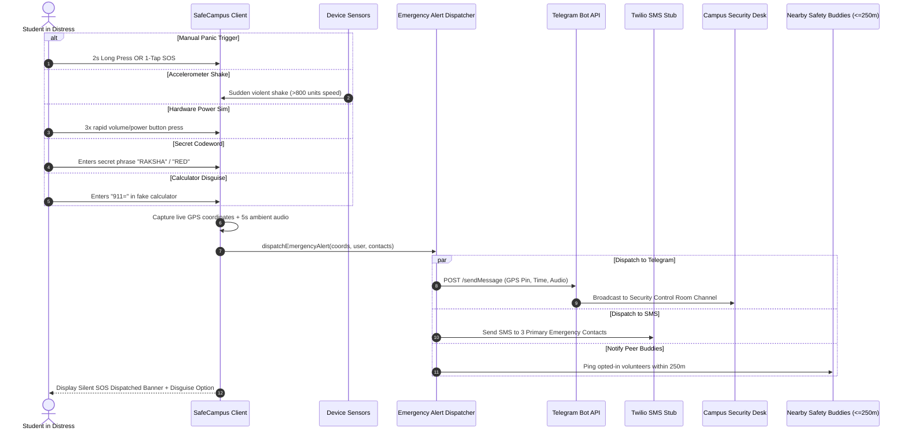
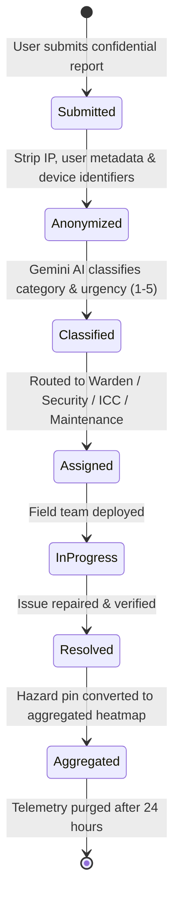

# SafeCampus (Raksha Path) — Architecture & System Design

SafeCampus (Raksha Path) is a mission-critical campus safety and issue resolution Progressive Web Application (PWA). It closes the complete safety loop:
$$\text{PREVENT (3D Safe Routes \& Heatmap)} \longrightarrow \text{RESPOND (Multi-Trigger Silent SOS)} \longrightarrow \text{FIX (Anonymous AI Reporting \& Admin Analytics)}$$

---

## 1. End-to-End System Architecture

```mermaid
graph TB
    subgraph Client["Student & Admin Client (PWA)"]
        UI["React 18 + Vite + Tailwind CSS"]
        SW["Service Worker (sw.js) & Cache Storage"]
        IDB["IndexedDB / LocalStorage Queue"]
        MapEngine["MapLibre GL JS (3D Vector Engine)"]
        Extrusions["3D Fill-Extrusion (Building Heights)"]
        VectorLayers["GeoJSON Clustering & Native Heatmap"]
        CameraPreview["3D Route Flight Camera Controller"]
        Router["Safe Route Weighted Pathfinding Engine"]
        Motion["DeviceMotion Accelerometer Listener"]
        Disguise["Stealth Calculator Mode"]
    end

    subgraph Basemaps["Map & Vector Tile Services"]
        OpenFreeMap["OpenFreeMap Vector Tiles (styles/liberty)"]
        RasterFallback["OSM 2D Raster Tile Fallback"]
    end

    subgraph AutoCampus["Auto Campus Map Pipeline"]
        Nominatim["OSM Nominatim Geocoding API"]
        Overpass["Overpass API (Ways & Buildings)"]
        CampusCache["Supabase / Local Campus Graph Cache"]
    end

    subgraph BackendServices["Backend Infrastructure (Supabase)"]
        SupaAuth["Supabase Auth (Student & Staff Roles)"]
        SupaDB[("PostgreSQL Database with Row Level Security")]
        SupaRealtime["Supabase Realtime Pub/Sub"]
        SupaStorage["Encrypted Media Storage"]
    end

    subgraph AI["Intelligent Incident Triage"]
        Gemini["Google Gemini API (1.5 Flash / 2.0)"]
        HeuristicNLP["Rule-based Keyword & Proximity Classifier"]
    end

    subgraph EmergencyChannels["Dispatch & Alert Gateways"]
        Telegram["Telegram Bot API (Security Control Room)"]
        Twilio["Twilio SMS Gateway"]
        Buddies["Peer Safety Buddies Notification"]
    end

    UI --> SW
    UI --> IDB
    UI --> MapEngine
    MapEngine --> Extrusions
    MapEngine --> VectorLayers
    MapEngine --> CameraPreview
    MapEngine --> OpenFreeMap
    OpenFreeMap -.->|On network/style error| RasterFallback

    UI --> Router
    UI --> Motion
    UI --> Disguise

    UI --> Nominatim
    Nominatim --> Overpass
    Overpass --> CampusCache

    UI --> SupaAuth
    UI --> SupaDB
    UI --> SupaRealtime
    UI --> SupaStorage

    UI --> Gemini
    Gemini -.->|Fallback if offline| HeuristicNLP

    UI --> Telegram
    UI --> Twilio
    UI --> Buddies
```

---

## 2. Silent SOS Multi-Trigger Sequence Flow

---

## 3. Safe Route Weighted Pathfinding & 3D Flight Preview (PREVENT)

The Safe Route Navigator models campus pedestrian walkways as a weighted directed graph $G = (V, E)$.

The edge weight $W(e)$ for path segment $e$ is computed as:
$$W(e) = D(e) + P_{\text{hazards}}(e) \times T_{\text{night}} - B_{\text{security}}(e) - B_{\text{lighting}}(e)$$

Where:
- $D(e)$: Base physical distance in meters.
- $P_{\text{hazards}}(e)$: Hazard penalty calculated from active incident reports within $80\text{m}$ (weighted by urgency $1\text{ to }5$).
- $T_{\text{night}}$: Night-time multiplier ($1.5\times$ risk factor after sunset).
- $B_{\text{security}}(e)$: Safety bonus for proximity ($<50\text{m}$) to 24/7 Security Booths or Women Helpdesks.
- $B_{\text{lighting}}(e)$: Illumination bonus for high-lumen solar LED corridors.

The engine computes two contrasting routes:
1. **Fastest Route**: Minimizes physical distance $D(e)$, allowing shortcuts through rear alleys. Shows raw hazard warnings and reduced safety index ($45\text{--}65/100$).
2. **Safest Route**: Minimizes safety weight $W(e)$, routing along patrolled boulevards and well-lit quads. Shows high safety index ($90\text{--}98/100$) and explains security checkpoints.

### 3D Route Flight Camera Preview
When the user clicks **Preview in 3D Flight**:
- The camera adjusts to **pitch 65°** (forward street-level low angle).
- MapLibre's `easeTo` glides across each waypoint over a smooth 10-second trajectory, calculating forward bearing angles.
- If `prefers-reduced-motion` is active on the user's OS, animation is disabled and replaced with instant bounding box framing.

---

## 4. Privacy by Design Data Lifecycle

